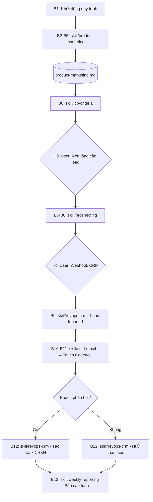

# MASTER WORKFLOW — TOÀN BỘ TIẾN TRÌNH VẬN HÀNH 13 BƯỚC

**Kết nối CRM:** các bước B9/B12 dùng `TINACRM_CONNECTION.md` làm quy tắc ưu tiên. Đọc/ghi qua REST API bằng `scripts/tinacrm_rest.py`, không dùng MCP của TinaCRM; không mặc định yêu cầu webhook nhập lead/task và không yêu cầu workspace ID riêng. Các payload, mẫu hỏi webhook bên dưới chỉ dành cho trường hợp workflow custom đã được thiết lập.

Tài liệu này mô tả chi tiết logic chuyển trạng thái, đầu vào, đầu ra và kịch bản hỏi người dùng cho từng bước trong quy trình.

**Kiến trúc ưu tiên:** [LOCAL_EXECUTION.md](LOCAL_EXECUTION.md) và [BUSINESS_ONBOARDING.md](BUSINESS_ONBOARDING.md). Claude Desktop điều phối với công cụ cục bộ; TinaCRM lưu lead và trạng thái theo workspace của doanh nghiệp. Mục tiêu lead/ngày, số email, lịch và người nhận báo cáo lấy từ `config/business.json` do Claude thiết lập với người dùng. Các ví dụ 4 email bên dưới chỉ là tham khảo. Lịch tự động cần được cấu hình và kiểm chứng bằng cơ chế thực thi thực tế trên máy người dùng.

---

## SƠ ĐỒ TIẾN TRÌNH TÍCH HỢP BỘ SKILLS

Quy trình vận hành sử dụng mô hình **Hub & Spoke Context** (tương thích chuẩn Agent Skills):
- File trung tâm: `product-marketing.md` (Single Source of Truth).
- Các gói kỹ năng chuyên môn:
  - `skills/product-marketing`: Bước 2 - 5
  - `skills/icp-criteria`: Bước 6
  - `skills/prospecting`: Bước 7 - 8
  - `skills/revops-crm`: Bước 9 & Bước 12
  - `skills/cold-email`: Bước 10 - 11
  - `skills/weekly-reporting`: Bước 13

---

## CHI TIẾT CÁC BƯỚC VÀ KỊCH BẢN TƯƠNG TÁC

### GIAI ĐOẠN 1: THẤU HIỂU DOANH NGHIỆP & ĐỊNH NGHĨA LEAD (B1 -> B6)
1. **Bước 1 (Khởi tạo):**
   - Kiểm tra folder `inputs/01_company_info/` và `inputs/02_marketing_materials/`.
   - Nếu trống, dùng câu mở đầu trong `USER_GUIDE_FLOW.md`: đưa lựa chọn tự đặt tài liệu (hướng dẫn mở Finder/File Explorer → `inputs/01_company_info/` hoặc `inputs/02_marketing_materials/`, sao chép và dán), gửi website hoặc trả lời từng câu.
2. **Bước 2 & 3 (Company Analysis):**
   - Subagent `01_company_analyst` đọc hồ sơ, xác định USP, sứ mệnh, phân khúc phục vụ.
   - Trình bày tóm tắt cho người dùng xác nhận.
3. **Bước 4 & 5 (Marketing Analysis):**
   - Subagent `02_marketing_strategist` phân tích giá trị giải pháp, điểm đau khách hàng, đối tượng mục tiêu.
   - Xác nhận với người dùng mục tiêu chiến dịch cụ thể.
4. **Bước 6 (ICP Synthesis):**
   - Hai subagent thảo luận tạo file `campaigns/<slug>/outputs/01_icp_criteria/icp_criteria.json` và `.md`.
   - Người dùng xem và duyệt qua bộ tiêu chí chấm điểm Lead.

---

### GIAI ĐOẠN 2: THU THẬP & ĐỒNG BỘ LEAD LÊN CRM (B7 -> B9)
5. **Chọn nguồn tìm khách (theo chiến dịch):** Claude phân tích ICP của chiến dịch, đề xuất 2–3 nguồn xếp theo độ phù hợp kèm lý do và rủi ro, người dùng chọn. Không mặc định LinkedIn. Chi tiết: `.claude/skills/prospecting/SKILL.md`.
6. **Đăng nhập nguồn:** người dùng tự đăng nhập trong cửa sổ CloakBrowser của chiến dịch; không xin mật khẩu, OTP, cookie hay token.

---

### GIAI ĐOẠN 3: KẾ HOẠCH CHĂM SÓC & TỰ ĐỘNG HÓA PHẢN HỒI (B10 -> B12)
8. **Bước 10 (Lên Routine Email Nurturing):**
   - Thiết kế chuỗi 4 email cá nhân hóa (Touchpoint 1, 2, 3, 4).
   - Xác nhận với người dùng về thời gian chờ (delay) giữa các email (Ví dụ: 0 ngày -> 3 ngày -> 6 ngày -> 10 ngày).
9. **Bước 11 (Cấu hình gửi mail & Lắng nghe phản hồi):**
   - **Kịch bản hỏi:**
     > *"Bạn muốn gửi email chăm sóc thông qua phương thức nào sau đây?*
     > 1. *Gửi qua Gmail API (Google Workspace)*
     > 2. *Gửi qua SMTP (Tên miền riêng công ty)*
     > 3. *Gửi qua nền tảng gửi mail (Resend, SendGrid, Mailchimp)*
     > 4. *Xuất danh sách nội dung ra file CSV để bạn tự import vào công cụ gửi mail hiện có?"*
10. **Bước 12 (Xử lý phân nhánh):**
    - Nếu khách trả lời: Hỏi thông tin webhook tạo Task của CRM:
      > *"Khách hàng [Tên công ty] vừa phản hồi tích cực! Vui lòng cung cấp webhook tạo Task trên CRM và email/ID nhân viên kinh doanh phụ trách để tôi tạo việc ngay lập tức."*
    - Nếu sau thời gian routine không phản hồi: Tự động cập nhật CRM sang trạng thái `Inactive / Huỷ chăm sóc`.

---

### GIAI ĐOẠN 4: ĐO LƯỜNG & BÁO CÁO (B13)
11. **Bước 13 (Báo cáo tuần):**
    - **Kịch bản hỏi:**
      > *"Hệ thống đã sẵn sàng tổng hợp báo cáo tuần.*
      > *Vui lòng cho biết:*
      > 1. *Địa chỉ email bạn muốn nhận báo cáo.*
      > 2. *Thời gian mong muốn nhận mail (Ví dụ: 08:00 sáng Thứ Hai hàng tuần).*"
    - Xuất file báo cáo `outputs/04_weekly_reports/weekly_summary_YYYY_MM_DD.md` và gửi qua email.
